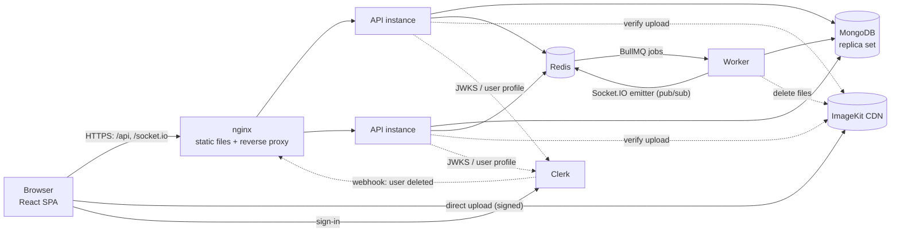

# Architecture

Vibe is a social network: profiles, follows (with private accounts and requests), posts with photos and
video, likes, reposts and quotes, threaded comments, a home feed, 24-hour stories, direct messages,
notifications, search and discovery.

This page is the map. Depth lives in [`INTERVIEW_NOTES.md`](INTERVIEW_NOTES.md) (every subsystem:
problem, alternatives, complexity, failure modes, bugs found) and the other docs in this folder.

## The system



| Process           | Runs                                                   | Scales by                                                          |
| ----------------- | ------------------------------------------------------ | ------------------------------------------------------------------ |
| **web** (nginx)   | Built React app; proxies `/api` and `/socket.io`       | More replicas; static files belong on a CDN                        |
| **api** (Node)    | Express REST API + Socket.IO gateway                   | Stateless: add instances. Sockets fan out via the Redis adapter    |
| **worker** (Node) | BullMQ consumers + scheduled maintenance               | Add instances; BullMQ hands each job to one worker                 |
| **MongoDB**       | Source of truth                                        | Indexes first, then read replicas, then sharding (see scalability) |
| **Redis**         | Caches, timelines, rate limits, queues, socket pub/sub | Split caches and queues into separate instances                    |

The API and worker are **one codebase and one image** with two entry points (`server.js`,
`worker.js`), so they always agree on models and job formats.

## Inside the API

```
apps/api/src
├── server.ts / worker.ts   entry points: wiring, graceful shutdown
├── app.ts                  Express pipeline (below); every dependency injected, so tests build the real app
├── config/                 env schema (zod), rate-limit policies, feed constants
├── infra/                  Mongo, Redis, Clerk, ImageKit, logger: the only code that talks to the outside
├── lib/                    errors, responses, pagination, rate limiter, cache-aside, shutdown
├── middleware/             auth, rate limit, timeout, error handler
├── realtime/               Socket.IO gateway (auth, rooms) and publishers (socket, emitter, recording)
└── modules/<feature>/      routes → service → model, one folder per feature
```

**Request pipeline:** request id + JSON log line → security headers (helmet) → CORS → health checks
(unauthenticated) → 15 s timeout → Clerk webhook (signature-verified, raw body) → JSON body (size-capped)
→ per-IP rate limit → **authentication** → per-user rate limit → feature router (onboarding check,
stricter write limits, zod validation) → service → `{ data, meta }` or `{ error }`.

**Layering rules:**

- Routes parse and validate (`validated(schema, handler)`); handlers never touch raw `req.body`.
- Services hold the rules and never see Express. Visibility decisions go through one pure policy module
  (`canSeeProfile`, `canViewContent`, `canReshare`, `canFollow`, `canMessage`).
- Lists are hydrated in batches (one query per related collection per page), never per item.
- Side effects that can wait (feed fan-out, notifications, cleanups) go to a queue; the request returns.

## Shared contracts

`packages/shared` holds zod schemas and DTO types used by both sides: the API validates input with the
same schema the web form uses, and the response types are compiled into both. A field renamed on one side
fails type-checking on the other.

## Key flows

**Post → followers' feeds.** `POST /posts` writes the post and enqueues a fan-out job. The worker pushes
the post id onto each follower's Redis timeline (a sorted set), except for authors with very many
followers, whose posts are merged in at read time instead. `GET /feed` reads ids from the timeline and
hydrates them from MongoDB. Details: [caching-strategy.md](caching-strategy.md).

**Upload.** The browser asks the API for a signed upload ticket (fixed folder, name, type and size), uploads
the bytes straight to ImageKit, then asks the API to verify the stored file against the ticket. The API
never handles file bytes. Unused uploads are deleted by a scheduled job.

**Message.** `POST /conversations/:id/messages` with a client-generated id (retries are idempotent), stored
in MongoDB, then pushed to the recipient's `user:<id>` room through Socket.IO. Other API instances and the
worker reach sockets they don't hold through the Redis adapter. A reconnecting client refetches.

**Notification.** An action (like, comment, reply, follow, follow request, request accepted) enqueues an event; the worker writes the
notification (deduplicated per recipient) and pushes a live update. If the action was undone in the
meantime, the worker deletes what it just wrote.

## Failure behaviour

| Dependency down | Effect                                                                                                           |
| --------------- | ---------------------------------------------------------------------------------------------------------------- |
| Redis           | Feeds served from MongoDB, caches miss, rate limiter fails open, jobs not enqueued (logged)                      |
| MongoDB         | Readiness fails, load balancer stops routing; requests 503                                                       |
| Clerk API       | Existing sessions still verify (cached JWKS or networkless key); first sign-ins fail                             |
| ImageKit        | Uploads and verification 503 (retried once by the browser); existing media is on the CDN                         |
| Worker          | Jobs wait in Redis and run when it returns: new posts reach feeds and notifications arrive late, nothing is lost |

Shutdown is graceful: readiness fails first so the load balancer drains the instance, in-flight requests
finish, sockets close, then connections. Details in INTERVIEW_NOTES ("Graceful shutdown").

## Running it

- Development: `npm run dev` (databases in Docker, apps from source with hot reload).
- Production build, locally: `npm run stack:up` → http://localhost:8080 (images from the `Dockerfile`).
- CI/CD: [`.github/workflows/ci.yml`](../.github/workflows/ci.yml): lint, types, tests, build, images;
  images published to GHCR from `main`.
